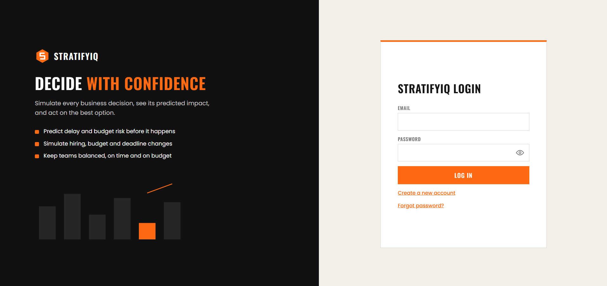
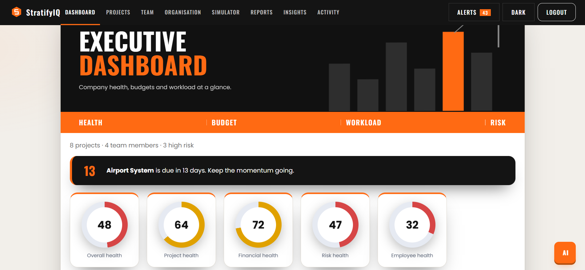
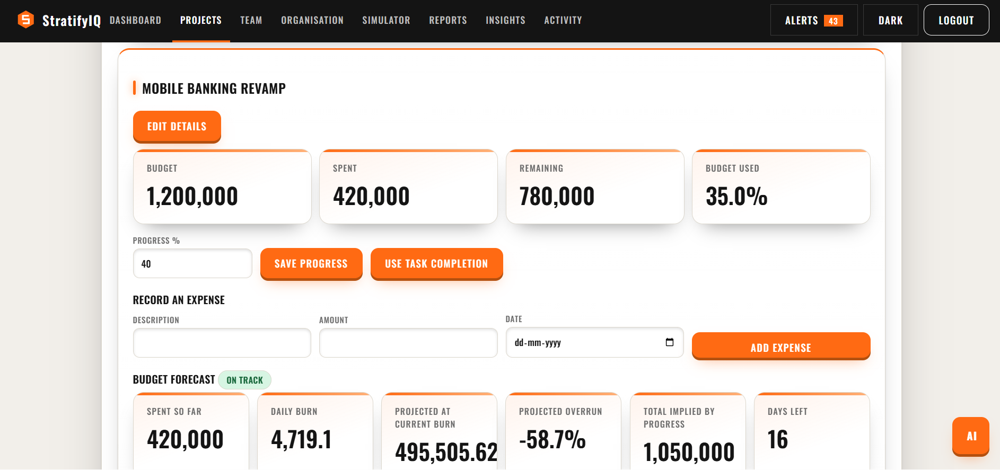
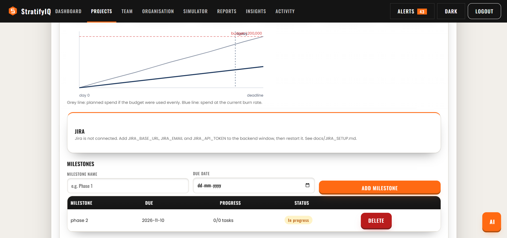
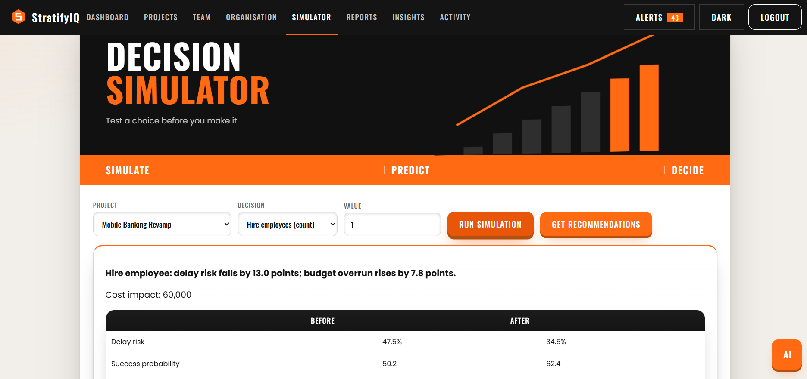
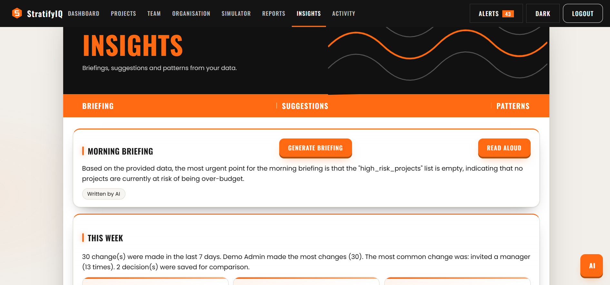

# StratifyIQ – Enterprise Decision Intelligence Platform (Backend)

## Setup
    python -m venv .venv && source .venv/bin/activate
    pip install -r requirements.txt

## Run
    python -m app.seed          # load demo data (admin@demo.com / Admin@123)
    uvicorn app.main:app --reload
    # API docs: http://127.0.0.1:8000/docs

## Test
    pytest -q

## Configuration
    DATABASE_URL   default sqlite:///./stratifyiq.db; use postgresql+psycopg2://... in production
    JWT_SECRET     must be changed outside development

## Screenshots

### Login

### Dashboard

### Projects

### Project detail

### Simulator

### Insights
