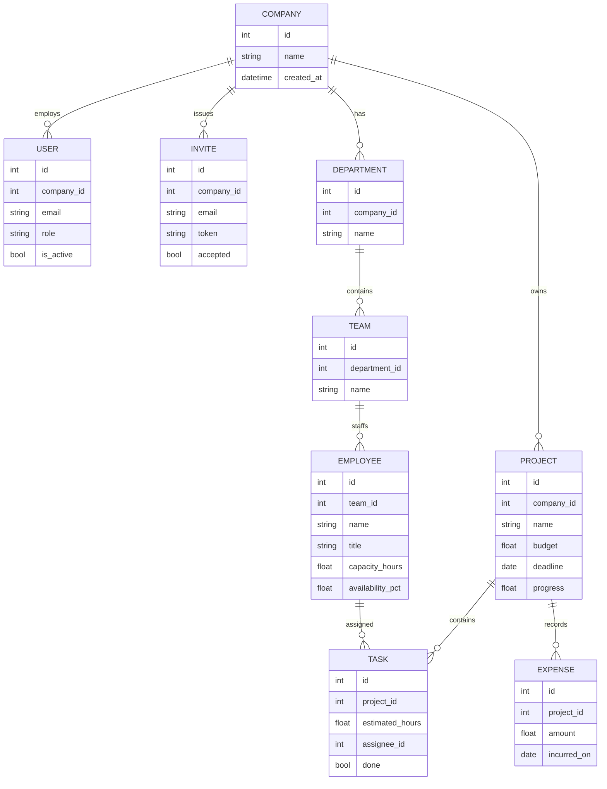

# StratifyIQ – Software Architecture

## 1. Purpose
StratifyIQ is a multi-tenant decision support platform. Its differentiator is that managers can simulate a business decision before committing to it, see the predicted effect on delay risk, budget overrun and success probability, and receive ranked recommendations.

## 2. System architecture
The system is a three-tier web application.

- **Presentation tier:** React single-page app (Vite). It calls the REST API with a JWT bearer token and renders the dashboards, forms and simulator.
- **Application tier:** FastAPI service in Python, split into routers (HTTP), schemas (validation), services (business and ML logic) and models (persistence).
- **Data tier:** PostgreSQL for transactional data. Models are trained at startup on synthetic data for the MVP and can later be retrained from stored history.

Each request is authenticated by JWT, authorised by role, and scoped to the caller's company. That company scope is enforced in one place (`app/deps.py: get_owned`), so a user can never read or change another company's rows.

## 3. Access control
Signup is self-service and creates a company workspace. The person who signs up becomes its Admin. Admins invite Managers by email; the invite token is single-use and expires after seven days. Users cannot sign up into an existing company directly. This keeps company data from being joined by strangers while still letting new companies start on their own.

| Action | Admin | Manager |
|---|---|---|
| Create company workspace (signup) | yes | — |
| Invite managers | yes | no |
| Create/edit departments, teams, employees, projects, tasks, budget | yes | yes |
| View all dashboards, predictions, simulations, recommendations | yes | yes |

## 4. Folder structure
```
stratifyiq/
├── app/
│   ├── main.py            FastAPI app, CORS, router registration
│   ├── config.py          environment settings
│   ├── db.py              engine, session, declarative Base
│   ├── models.py          SQLAlchemy tables
│   ├── schemas.py         Pydantic request models
│   ├── security.py        password hashing, JWT creation
│   ├── deps.py            current user, role guard, tenant-owned lookups
│   ├── seed.py            demo data loader
│   ├── routers/
│   │   ├── auth.py        signup, login, invites, password reset stub
│   │   ├── core.py        company, departments, teams, employees, projects, tasks, budget
│   │   └── analytics.py   predict, simulate, recommend, dashboard
│   └── services/
│       ├── metrics.py     project snapshot, feature derivation, utilisation
│       ├── ml.py          prediction models and risk levels
│       ├── simulator.py   what-if decision engine
│       ├── recommender.py candidate scoring and ranking
│       └── health.py      project and employee health scores
├── tests/test_api.py
├── docs/schema.sql, docs/ARCHITECTURE.md, docs/API.md
├── requirements.txt
└── README.md
```

## 5. Module to endpoint mapping
| Requirement module | Where it is implemented |
|---|---|
| 1 Authentication and RBAC | `routers/auth.py`, `deps.py` |
| 2 Company workspace | `routers/core.py` (company, departments, teams) |
| 3 Employee management | `routers/core.py` (employees, workload) |
| 4 Project management | `routers/core.py` (projects, tasks, progress) |
| 5 Budget management | `routers/core.py` (budget allocation, expenses, summary) |
| 6 Decision Simulator | `services/simulator.py`, `analytics.py /simulate` |
| 7 AI Prediction Engine | `services/ml.py`, `analytics.py /predict` |
| 8 AI Recommendation Engine | `services/recommender.py`, `analytics.py /recommend` |
| 9 Dashboards | `analytics.py /dashboard` (JSON for the React dashboard; Power BI is Phase 2) |
| 10 Notifications | Phase 2 (alerts can be derived from `/dashboard` high-risk list) |
| 11 Reports | Phase 2 (PDF and Excel export) |
| 12 Business Health Score | `services/health.py`, `analytics.py /dashboard` |

## 6. Data model (ER diagram)

The full DDL is in `docs/schema.sql`.

## 7. Machine learning approach
Three random-forest regressors (scikit-learn, 100 trees, depth 8) predict delay risk (0 to 1), success probability (0 to 100) and budget overrun (percent). Their inputs are six features derived from the project: budget used ratio, progress, workload ratio (open hours against team capacity over the time left), days left, team size and scope.

For the MVP, the models are trained on a synthetic dataset of 3,000 projects. Labels follow documented rules: delay grows with workload above capacity and with spending ahead of progress, and overrun grows with the same spending gap. Noise is added. This is stated openly as a limitation. The interface is the same for real data, so the models can be retrained on historical projects once the platform has them.

The Decision Simulator changes the inputs and re-runs the models. Hiring adds a team member and their monthly cost. Extending the deadline adds days. Reducing scope cuts open hours. Increasing or reducing budget changes the budget ratio. Reallocating resources removes half of any excess workload, which is an assumption to state in the report. The simulator never writes to the database.

The recommendation engine evaluates seven candidate decisions, scores each by a weighted objective (delay risk weighted most heavily, then overrun, then low success probability, then decision cost as a share of budget, then a penalty for scope cuts), and returns the three best against a do-nothing baseline.

## 8. Business health score
Project health has three parts: financial (penalised by predicted overrun), schedule (inverse of delay risk) and workload (penalised when load exceeds capacity). Employee health penalises utilisation above 100% and below 40%. The company score combines project health, employee health, financial health, risk health and an overall score.

## 9. Security notes
Passwords are hashed with bcrypt. JWTs are signed with HS256 and expire after 12 hours by default. Role checks run on the server, not in the UI. The `JWT_SECRET` must be set from the environment in any deployment. The forgot-password endpoint returns the same response for every address so that accounts cannot be discovered.

## 10. Scope for this submission
In scope: authentication and RBAC, company workspace, employees, projects, tasks, budget, the simulator, the prediction and recommendation engines, the executive dashboard JSON, and the health score.

Phase 2 (documented as future work): email delivery for invites and password reset, notifications, PDF and Excel reports, standalone Power BI files, Jira, GitHub, Teams and Slack integrations, and retraining on real history.
