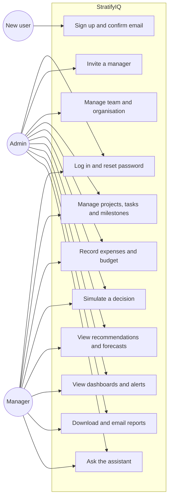
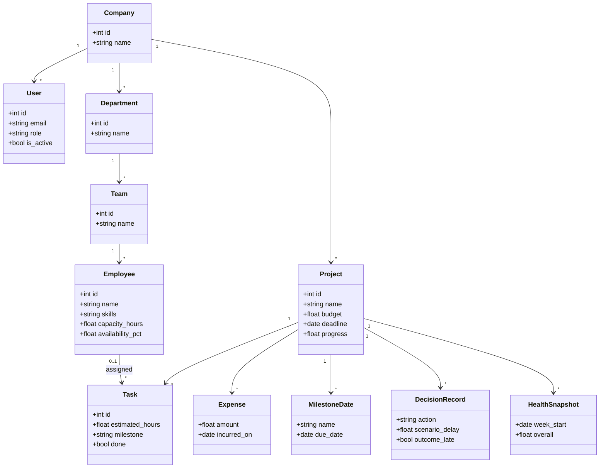
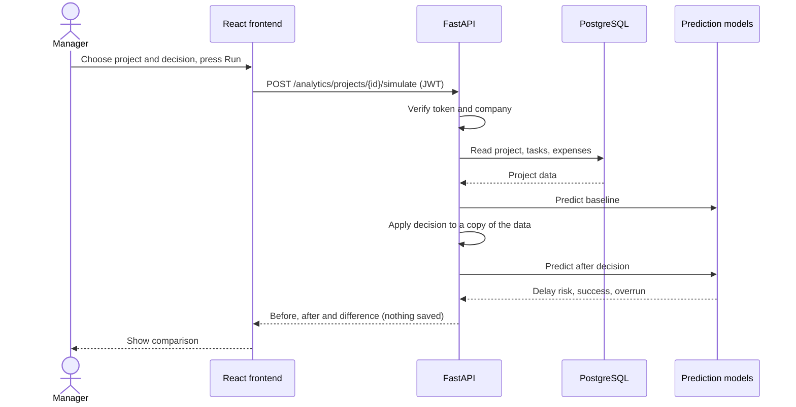
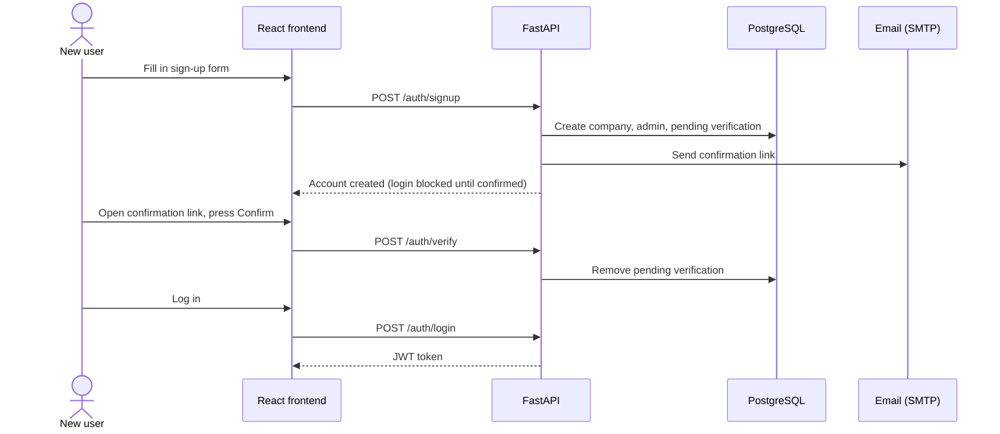

# StratifyIQ UML diagrams

These diagrams use Mermaid. They render on GitHub, and in VS Code with a Mermaid extension.

## 1. Use case diagram

## 2. Class diagram (main data model)

## 3. Sequence diagram: simulating a decision

## 4. Sequence diagram: sign-up with email confirmation

